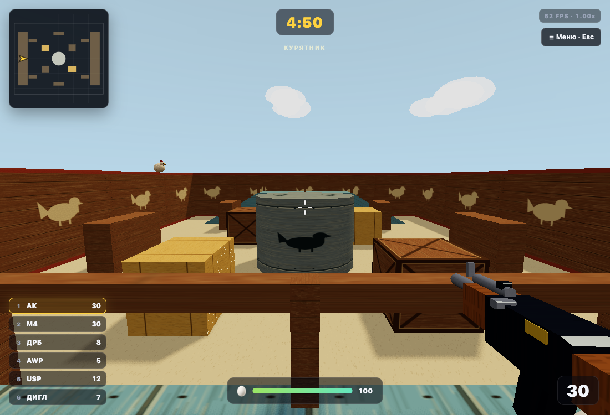

# ЯЙЦА · EGG STRIKE

Онлайн-перестрелка яйцами для 3–4 игроков. Комната по коду, один раунд — 5 минут.



## Запуск

Нужен Node.js 18+.

```bash
npm install
npm start
```

Открой [http://localhost:3000](http://localhost:3000).

Для воспроизводимой установки из lock-файла: `npm ci`. Для разработки и браузерных тестов нужен Node.js 20+ (сам сервер поддерживает 18+).

```bash
npm test                     # физика, четыре карты, стрельба, гранаты и WebSocket
npx playwright install chromium
npm run test:browser          # интерфейс, четыре карты, движение и гранаты
```

Проверки сами запускают отдельный сервер на свободном порту и останавливают его после завершения. Отдельный сценарий: `node scripts/test.mjs tests/test-sprint.mjs`. Пути к Playwright больше не зависят от компьютера автора; `CHROMIUM` позволяет указать свой браузер.

## Меню

При входе — лобби с персонажем и выбором карт **«Курятник»**, **«Полигон»**, **«Холодильник»** и **«Кухня»**. Карточка показывает вместимость; выбери карту, создай комнату или войди по коду.

Для «Курятника» единственный источник координат — [henhouse_ffa_level.json](public/henhouse_ffa_level.json), исходный файл пользователя скопирован без изменений. Сервер строит коллизии из него; клиент использует те же данные для движения, мешей и миникарты. Превью в меню также генерируется из JSON.

Двор 20×16 м, стены высотой 3 м и толщиной 0,3 м внутри границ пола. В центре цилиндрическая кормушка радиусом 1,55 м и высотой 2,2 м. Десять укрытий, два помоста с верхом на Y=1,8, четыре пандуса и восемь опор размещены строго по JSON. Нижняя поверхность настила — Y=1,6. Коллизия игрока: радиус 0,34 м, высота 1,15 м, шаг 0,23 м; скорость ходьбы — 4,5 м/с.

Четыре спавна находятся на земле и смотрят в центр. При появлении действует защита 1,5 секунды. Сервер выбирает свободную позицию, предпочитает защищённые от прямой видимости места и максимальную дистанцию до врагов. Вместимость комнаты — четыре игрока; карту можно осмотреть одному.

Оформление «Курятника» меняет материалы и добавляет только декоративные элементы, привязанные к существующим объектам. Крыш над его игровым пространством нет. Геометрия оформленной карты совпадает с blockout.

Для проверки уровня открой:

- `/?blockout=1&mapdebug=1&debug=1` — играбельный blockout, сетка 1 м, имена объектов, границы коллайдеров, спавны и высоты проходов.
- `/?mapdebug=1&debug=1` — то же для оформленной карты.
- **F2** скрывает и показывает диагностический слой. Доступен при запуске с `mapdebug=1`.

## Готовая карта «Полигон»

«Полигон» — импортированная сцена [Collision World из Three.js](https://github.com/mrdoob/three.js/blob/87948e3fb1d14ad5c8e27b67def8e479780b0292/examples/models/gltf/collision-world.glb), автор Paul Brunt, лицензия MIT. Размер после равномерного увеличения ×2 — 68,7 × 68,7 м, почти в 15 раз больше площади «Курятника». Сохранены все 1754 исходных треугольника и встроенная текстура. Восемь точек появления используются комнатой до четырёх игроков.

Исходный GLB, лицензия и производные данные лежат в `public/maps/training/`. `scene.json` задаёт одну и ту же геометрию рендера, движения и серверных попаданий; столкновения проверяются через Three.js Octree, включая обе стороны исходных поверхностей. Падение ниже уровня возвращает игрока на свободный спавн. Миникарта и карточка используют проекцию исходной сцены.

Все ресурсы, включая Three.js, загружаются локально. Повторный импорт сохранённого оригинала: `node scripts/import-training-map.mjs`. Источник, автор, масштаб и SHA-256 записаны в `map.json` и `scene.json`.

## Компактные карты для троих

| Карта | Размер | Укрытия и маршруты |
| --- | --- | --- |
| Холодильник | 16×14 м | Пакеты молока и сока, масло, банки и яичный контейнер; центральная сырная полка высотой 1,2 м с двумя подъёмами. |
| Кухня | 18×14 м | Деревянная столешница, тостер, хлебница и банка печенья; разделочная доска высотой 0,85 м с двумя подъёмами. |

На каждой карте три места появления без прямой видимости друг друга. Вокруг укрытий можно пройти по полу, на центральную площадку — подняться с двух сторон без прыжков. Лимит комнаты — три игрока; если в комнате четверо, выбрать компактную карту нельзя. Осмотреть карту можно одному.

Координаты в `public/household-maps.js` общие для сервера, движения, пуль, гранат, миникарты и превью. У холодильника есть настоящий потолок: он останавливает гранаты и выстрелы, но не перекрывает миникарту. Полосы на подъёмах помогают видеть их края.

Плитка, древесина, пластик, металл и этикетки — оригинальные процедурные текстуры из `public/household-world.js`, создаваемые локально через Canvas. Новых сторонних изображений и загрузок с внешних сайтов нет. В холодильнике холодное освещение и тихий гул; на кухне — тёплые цвета и шаги по дереву.

Проверки новых карт: `node scripts/test.mjs tests/test-household-maps.mjs tests/test-household-server.mjs tests/test-household-ui.mjs`. Они проверяют связность маршрутов, спавны и вместимость, точность мешей относительно коллизий, движение по всем подъёмам в обе стороны, три подключённых клиента, урон, гранаты и четыре карточки на маленьких экранах.

## Как играть с друзьями

Самый быстрый способ поднять сервер и публичную ссылку сразу:

```bash
./play.sh
```

Дальше — по шагам.

1. Один создаёт комнату и кидает друзьям код из 4 символов (или кнопку «Скопировать ссылку»).
2. Остальные открывают ту же страницу, вводят имя и код, жмут «Войти».
3. Хост жмёт «Начать бой» — у всех стартует раунд на 5 минут.

Подключиться можно в любой момент, даже в середине боя: новичок сразу появляется на арене с полным здоровьем.

Ссылка-приглашение (`/?room=КОД`) сама заводит в лобби: если имя уже сохранено в браузере — сразу, иначе код уже подставлен в поле, остаётся ввести имя и нажать «Войти». Сама ссылка видна в лобби отдельным полем.

С экрана результатов можно вернуться в лобби кнопкой «В лобби», не выходя из комнаты. Если смерть затянулась — на экране смерти появится «Переподключиться».

**Если вы в одной сети (Wi-Fi):** хост открывает `http://<его-local-ip>:3000`, друзья заходят по этому адресу.

**Если вы в разных городах:** нужен публичный адрес. Проще всего — SSH-туннель без аккаунта:

```bash
ssh -R 80:localhost:3000 nokey@localhost.run
```

В выводе будет ссылка вида `https://xxxx.lhr.life` — её и кидай друзьям. Пока команда выполняется, ссылка жива.

Альтернативы: `cloudflared tunnel --url http://localhost:3000` (даёт `https://*.trycloudflare.com`) или `npx localtunnel --port 3000`.

Другой вариант — залить папку на любой хостинг с Node.js (Render, Railway, Fly.io): старт-команда `node server.js`, порт берётся из `PORT`.

## Управление

| Клавиша | Действие |
| --- | --- |
| WASD | бег |
| Shift (удерживать) | спринт: скорость ×2 с расходом энергии |
| мышь | прицел |
| ЛКМ | огонь |
| ПКМ (удерживать) | прицеливание; у снайперки — оптика |
| 1–6 или колесо | смена оружия |
| R | перезарядка |
| G | бросить гранату |
| Space | прыжок |
| Tab (удерживать) | таблица счёта |
| Esc | пауза |

Граната привязана к физической клавише **G** при любой раскладке. Русская «Г» на клавише U гранату не бросает. Удержание G не расходует весь запас.

На каждую жизнь выдаются **две гранаты**. Они летят по дуге, отскакивают от пола и препятствий и взрываются через **2,5 секунды**; перерыв между бросками — 0,6 секунды. Радиус взрыва — 5 м, урон уменьшается с расстоянием от максимальных 120. Сплошные укрытия и защита после появления закрывают от взрыва; свою гранату тоже стоит избегать. Самоподрыв не приносит убийство в счёт.

Справа в HUD виден запас; рядом с летящей гранатой появляется предупреждение с оставшимся временем. Все игроки видят одну серверную траекторию и взрыв. Гранаты пополняются при возрождении и новом раунде; выход владельца из боя убирает его активные гранаты.

В меню и в паузе есть кнопка **«⛶ На весь экран»** (плюс обычный F11 в браузере).

Спринт ускоряет движение с 4,5 до 9 м/с. Полной энергии хватает на 4 секунды непрерывного спринта; восстановление с нуля занимает 5 секунд обычного движения или отдыха. Индикатор энергии расположен над здоровьем. Без движения и при упоре в стену энергия не тратится. После истощения отпусти Shift и нажми снова, когда энергия восстановится. При возрождении и начале раунда энергия полная.

## Оружие

| # | Оружие | Урон | Магазин | Темп |
| --- | --- | --- | --- | --- |
| 1 | AK-47 | 29 | 30 | 400 |
| 2 | M4A4-S | 24 | 30 | 444 |
| 3 | Дробовик | 12 × 9 дробин | 8 | 50 |
| 4 | Снайперка | 100 | 5 | 28 |
| 5 | USP-S | 19 | 12 | 233 |
| 6 | Дигл | 52 | 7 | 160 |

Чувствительность мыши и чувствительность в прицеле настраиваются в меню «Настройки» (или Esc → Настройки) и сохраняются в браузере.

Патроны видны внизу экрана у каждого ствола. Перезарядка ручная (R) и автоматическая, когда магазин пуст.
Имена игроков доступны в комнате и таблице счёта. Над персонажами нет имён и полосок здоровья.

## Стрельба и звук

У каждого оружия свой толчок, подброс и скорость возврата. Вспышка, короткий дым и гильза появляются сразу после выстрела; точки попаданий и вся дробь приходят от сервера одинаковыми для обоих игроков. Маркер попадания и убийства показывается после серверного подтверждения. Яйцо реагирует на урон, при смерти разлетаются осколки скорлупы.

Отдача двигает оружие, а прицел остаётся стабильным: одиночные пули и автоматическая очередь идут по центру без случайного разброса. У дробовика сохраняется разброс девяти дробин. Перед каждым выстрелом обновляется позиция стрелка; сервер учитывает отображённое положение противника с компенсацией задержки до 250 мс. Укрытия продолжают останавливать пули.

Прыжок сохраняет исходную высоту примерно 1,4–1,6 м и полную скорость перемещения в воздухе. После приземления можно сразу прыгнуть повторным нажатием Space.

На дереве появляются щепки, на металле — искры, на земле — пыль. Выстрелы и попадания учитывают расстояние и направление. Шаги по галереям и земле звучат по-разному; свои шаги тише чужих. В фоне тихо слышны ветер, куры и скрип дерева.

Эффекты ограничены: до 60 частиц, 20 гильз, 36 следов и 32 трассеров. Геометрия переиспользуется, объекты исчезают по времени. Смена оружия отменяет звуки перезарядки; смерть и выход в комнату очищают боевые эффекты.

## Правила

- Яйцо = 100 HP. У каждого ствола свой урон, магазин и скорость перезарядки.
- Снайперка убивает с одного попадания, дробовик — в упор.
- «Курятник» 20×16 м и «Полигон» 68,7×68,7 м — до 4 игроков; «Холодильник» 16×14 м и «Кухня» 18×14 м — до 3.
- Погиб — возрождение через 2 секунды на свободном безопасном спавне (на экране смерти идёт полоска).
- 5 минут, побеждает тот, у кого больше убийств.
- Хост может запустить ещё раунд с экрана результатов.

## Производительность

- В игре слева сверху виден FPS и текущий масштаб рендера. Скрыть/показать — **F3**.
- Разрешение рендера всегда 100% (pixel ratio 1.0, без MSAA и авто-масштабирования) — буфер не пересоздаётся на ходу.
- Тени считаются один раз при старте арены; яйца получают дешёвые блобы вместо динамических теней.
- Материалы мира — Lambert/Phong вместо PBR, это заметно дешевле на слабых GPU.

## Звуки

- Выстрелы и перезарядка — [Mixkit](https://mixkit.co/free-sound-effects/gun/) (Mixkit License).
- Шаги — [Mixkit](https://mixkit.co/free-sound-effects/footsteps/) (Mixkit License): свои тише, чужие с панорамой и затуханием по расстоянию, вдали приглушаются фильтром.
- Очередь ППШ — Still North Media, CC0, [sound-effects-library-weapons](https://github.com/PanderMusubi/sound-effects-library-weapons).

## Настройки

Переменные окружения:

- `PORT` — порт (по умолчанию 3000)
- `MATCH_TIME` — длина раунда в секундах (по умолчанию 300)

## Структура

```
server.js        — HTTP-сервер + WebSocket, комнаты, матч, попадания
public/index.html
public/style.css
public/game.js   — three.js: арена, яйца, стрельба, HUD, Web Audio
public/combat-effects.js — профили оружия и ограниченные эффекты
public/grenade-physics.js — серверная физика гранат, отскоки и урон за укрытиями
public/grenade-effects.js — отображение серверных гранат и взрывов
public/henhouse_ffa_level.json — единственный источник координат
public/henhouse-level.js — преобразование JSON и превью
public/household-maps.js — общие координаты и превью холодильника и кухни
public/household-world.js — оригинальные текстуры, свет и оформление компактных карт
public/coop-world.js — геометрия blockout и диагностика
public/mesh-world.js — геометрия и общие столкновения готовой сцены
public/maps/training/ — оригинальная карта, текстура, геометрия и лицензия
public/henhouse-dressing.js — оформление без коллизий
public/vendor/   — three.js
```

Комнаты живут в памяти процесса: перезапустил сервер — комнаты пропали. Базы данных нет.

На «Курятнике» подъёмы и края помостов отмечены светлыми полосами, спавны — цветными кольцами. На «Полигоне» разделены оттенки пола и стен, добавлены контуры перепадов и ориентиры появления. Разметка не добавляет препятствий. Столкновения «Полигона» проверяют отдельные контакты: склон больше не скрывает упор в стену, а внутренние швы плоских треугольников не цепляют игрока. Подъём на небольшой уступ одинаково обрабатывается при ходьбе и спринте; при спуске персонаж держится поверхности пандуса, а с большого обрыва падает естественно.

## Проверки карты

```bash
PORT=3190 MATCH_TIME=300 node server.js
# В другом терминале:
node tests/test-henhouse-level.mjs
node tests/test-henhouse-spawns.mjs
node tests/test-henhouse-ui.mjs
MODE=dressed node tests/test-henhouse-ui.mjs
BASE=http://127.0.0.1:3190 node tests/test-coop-cover.mjs
node tests/test-map-layout.mjs
node tests/test-coop-geometry.mjs
```

Playwright работает в отдельном headless Chromium. `CHROMIUM` задаёт путь к браузеру, `BASE` — адрес сервера. Сервисы, WebSocket и 3D-сцены настоящие; Three.js загружается локально. Проверяются точные размеры мешей, четыре подъёма по пандусам, прыжок с помоста, проход снизу, потолок, кормушка, стены, диагностика и выход. Скриншоты: `/tmp/henhouse-blockout.png` и `/tmp/henhouse-dressed.png`.

Серверные сценарии проверяют все шесть пар спавнов на отсутствие прямой видимости, связность наземных маршрутов, вместимость комнаты, уникальные спавны для трёх игроков, подключение четвёртого, защиту после появления и безопасный респавн. Проверка укрытий выполняется после окончания защиты, чтобы она не маскировала ошибки коллизий.

Проверка выхода из боя и комнаты:

```bash
PORT=3140 MATCH_TIME=60 node server.js
# В другом терминале:
node tests/test-exit.mjs
```

Для проверки окончания раунда во время ожидания в комнате запусти сервер с коротким раундом и тот же сценарий:

```bash
PORT=3150 MATCH_TIME=12 node server.js
# В другом терминале:
BASE=http://127.0.0.1:3150 SCENARIO=round-end node tests/test-exit.mjs
```

Проверка стрельбы и звука:

```bash
PORT=3180 MATCH_TIME=300 node server.js
# В другом терминале:
node tests/test-shot-results.mjs
node tests/test-gunfeel.mjs
```

Первый сценарий проверяет настоящие WebSocket-результаты: дерево, металл, землю, противника и все девять дробин. Playwright проверяет двух игроков, управление мышью и клавиатурой, шесть профилей отдачи, шаги по балконам, серверные подтверждения, частицы и очистку. Web Audio запускается в браузере; автоматические проверки не заменяют прослушивание и оценку удобства отдачи человеком.

Проверка прыжков и точности стрельбы на отдельном сервере:

```bash
PORT=3191 MATCH_TIME=600 node server.js
# В другом терминале:
BASE=http://127.0.0.1:3191 node tests/test-jump-feel.mjs
BASE=http://127.0.0.1:3191 node tests/test-sprint.mjs
BASE=http://127.0.0.1:3191 node tests/test-combat-accuracy.mjs
BASE=http://127.0.0.1:3191 node tests/test-hit-rewind.mjs
```

Playwright проверяет исходную высоту прыжка, полную скорость в воздухе и повторный прыжок без задержки, направление и начало выстрела, попадание по видимому движущемуся противнику с задержкой обновлений 120 мс и очередь в упор. Серверный сценарий дополнительно проверяет интерполяцию между снимками, границы компенсации, укрытия и возрождение.

Сценарий спринта проверяет оба Shift, удвоение скорости, расход и восстановление энергии, истощение без рывков скорости, упор в стену, HUD и пополнение энергии при возрождении и новом раунде.

Проверки готовой карты на том же сервере:

```bash
node tests/test-mesh-world.mjs
BASE=http://127.0.0.1:3191 node tests/test-training-server.mjs
BASE=http://127.0.0.1:3191 node tests/test-training-map.mjs
BASE=http://127.0.0.1:3191 node tests/test-ui-copy.mjs
```

Проверяются происхождение GLB, 40 лучей против независимого Three.js Raycaster, восемь свободных спавнов, серверные укрытия и урон, падение, выбор карты двумя игроками, движение и подъём, локальная текстура, возврат на «Курятник» и расположение четырёх карточек на мобильном экране.
